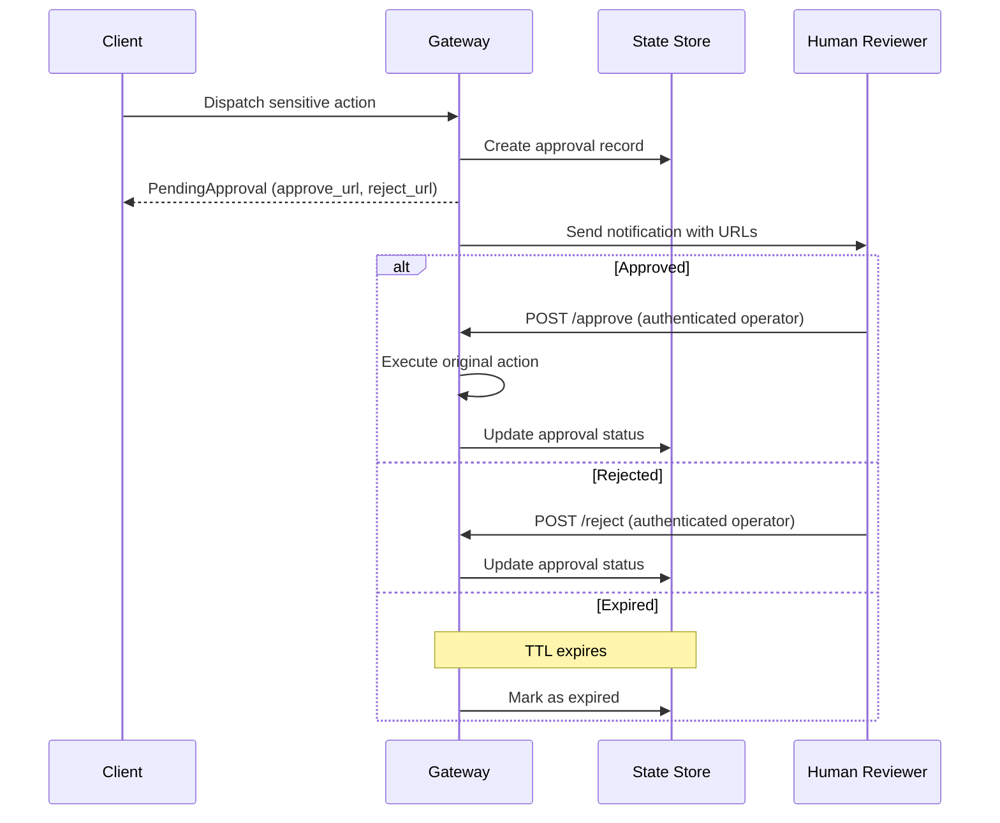
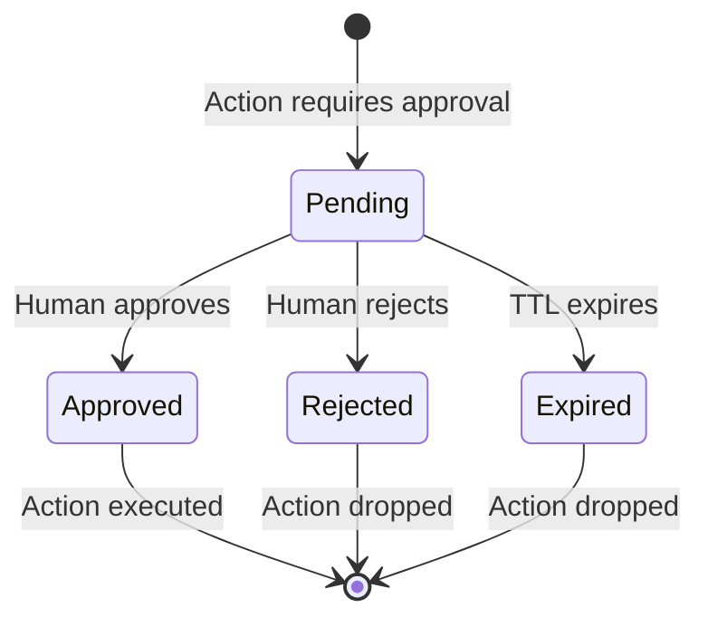

# Human Approvals

The approval system enables human-in-the-loop workflows. Sensitive actions are held pending until a human approves or rejects them via signed URLs.

## How It Works



1. An action matching a `request_approval` rule creates an approval record
2. Approval URLs are generated; decisions require an operator credential
3. A notification is sent to reviewers
4. The action is held until approved, rejected, or expired

## Rule Configuration

```yaml title="rules/approvals.yaml"
rules:
  - name: approve-production-deploys
    priority: 1
    description: "Production deployments require human approval"
    condition:
      all:
        - field: action.action_type
          eq: "deploy"
        - field: action.metadata.environment
          eq: "production"
    action:
      type: request_approval
      message: "Production deployment requires approval"
      notify_provider: email
      timeout_seconds: 3600
```

### Parameters

| Parameter | Type | Required | Description |
|-----------|------|----------|-------------|
| `notify_provider` | string | Yes | Registered provider used for the approval notification |
| `message` | string | No | Message shown to the reviewer |
| `timeout_seconds` | u64 | No | Time before the approval expires (default: 1 hour) |

## Response

```json
{
  "PendingApproval": {
  "approval_id": "apr-abc123",
  "expires_at": "2026-01-15T11:00:00Z",
  "approve_url": "/v1/approvals/apr-abc123/approve",
  "reject_url": "/v1/approvals/apr-abc123/reject",
  "notification_sent": true
  }
}
```

## Approval URLs

Approval decisions require an authenticated operator or admin credential in the
approval's namespace and tenant. URL signatures do not authorize HTTP access.
The server checks ownership and expiration before executing a decision.

### Approving an Action

```bash
curl -X POST -H "Authorization: Bearer $ACTEON_OPERATOR_TOKEN" "http://localhost:8080/v1/approvals/apr-abc123/approve"
```

### Rejecting an Action

```bash
curl -X POST -H "Authorization: Bearer $ACTEON_OPERATOR_TOKEN" "http://localhost:8080/v1/approvals/apr-abc123/reject"
```

## API Endpoints

### List Pending Approvals

```bash
curl -H "Authorization: Bearer $ACTEON_OPERATOR_TOKEN" "http://localhost:8080/v1/approvals"
```

### Get Approval Status

```bash
curl -H "Authorization: Bearer $ACTEON_OPERATOR_TOKEN" "http://localhost:8080/v1/approvals/apr-abc123"
```

## Approval States



## Client SDK Support

=== "Rust"

    ```rust
    // Approve
    client.approve("apr-abc123").await?;

    // Reject
    client.reject("apr-abc123").await?;

    // List pending
    let approvals = client.list_approvals().await?;

    // Get status
    let status = client.get_approval("apr-abc123").await?;
    ```

## Use Cases

- **Production deployments** — require team lead approval
- **Financial transactions** — require manager sign-off above threshold
- **Data deletion** — require compliance team approval
- **Access grants** — require security team approval
