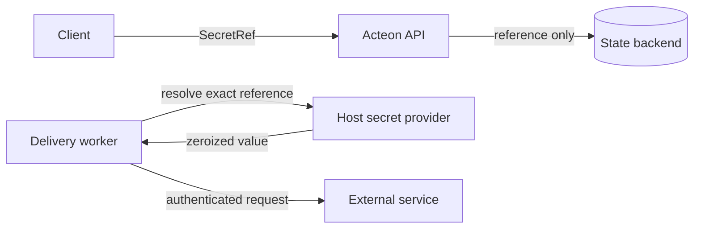

# Secret custody

Durable execution often outlives the process that accepted it. Credentials
needed by a later callback therefore cannot live only in a request, but storing
their plaintext beside task state exposes them through backups, backend access,
and accidental projections. Acteon stores a typed reference and asks the host
for the value only at the final effect boundary.



## Reference contract

Every reference contains a provider namespace, a provider-local logical key,
and an optional immutable version:

```json
{
  "provider": "environment",
  "key": "callbacks/incident-router",
  "version": "2026-10"
}
```

Provider, key, and version are bounded non-secret identifiers. Acteon rejects
unknown providers, malformed references, unregistered keys, and version
mismatches. Provider failures reveal no secret-store payload.

The built-in environment adapter is allowlisted. A reference cannot name an
arbitrary process variable. The operator maps each logical key to a variable:

```toml
[[secret_custody.environment]]
key = "callbacks/incident-router"
env = "ACTEON_INCIDENT_CALLBACK_TOKEN"
version = "2026-10"
namespace = "observability"
tenant = "acme"
purposes = ["a2a.callback.authorization"]
audiences = ["https://incident-router.example/a2a"]
```

Each binding is limited to an exact namespace and tenant, one or more purposes,
and explicit callback audiences. Acteon refuses to resolve the value if a caller
changes the callback URL, preventing a callback manager from redirecting a host
credential to another endpoint. Values are read when an effect is attempted,
allowing the host to refresh a mounted or injected value without rewriting task
state. The configured version must match a pinned reference. Custom Vault,
cloud secret-manager, or HSM adapters implement the `SecretProvider` trait and
register their own provider namespace.

## A2A callback credentials

Callback tokens and authorization credentials accept references:

```json
{
  "taskId": "task-alpha",
  "id": "incident-hook",
  "url": "https://incident-router.example/a2a",
  "tokenRef": {
    "provider": "environment",
    "key": "callbacks/notification-token",
    "version": "2026-10"
  },
  "authentication": {
    "scheme": "Bearer",
    "credentialsRef": {
      "provider": "environment",
      "key": "callbacks/incident-router",
      "version": "2026-10"
    }
  }
}
```

An inline value and its corresponding reference are mutually exclusive. Inline
fields remain accepted for wire compatibility, but references are the
production path: task envelopes, state backends, audit records, management
responses, and SDK objects contain only the reference.

Resolution happens after the worker owns the callback's fenced delivery lease
and immediately before request construction. An unavailable provider produces
a retryable delivery failure. An invalid, unknown, revoked, or version-mismatched
reference fails closed and enters the normal callback dead-letter workflow.

## Rotation and recovery

To rotate a pinned credential:

1. Install the new version in the host provider.
2. Update the callback to reference that version. Active deliveries fence
   concurrent configuration changes.
3. Observe successful delivery with the new reference.
4. Revoke the old version.

A restart reloads the reference and callback cursor from the configured state
backend, then resolves the value again. No credential bytes need to be restored
from durable state.

Run the executable lifecycle:

```bash
cargo run -p acteon-simulation --example secret_custody_simulation
```

The simulation persists a callback, proves its serialized state excludes the
credential, resolves it after a simulated worker restart, rotates from `v1` to
`v2`, proves the revoked version fails closed, and refuses a redirected callback
audience.
