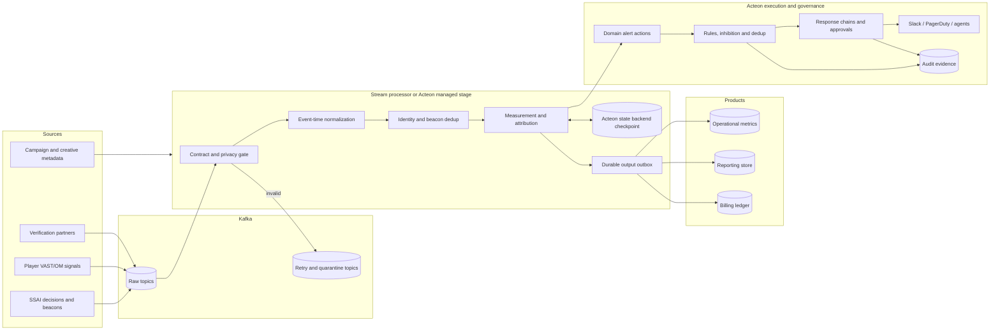

# Build a billing-grade ads measurement pipeline

An ads pipeline turns tiny, repeated signals into money and product truth. A
missing impression can under-report delivery. A duplicated impression can
overbill an advertiser. A late completion changes campaign performance, while a
late click can change attribution. During a live CTV event, all of those failures
can arrive together.

This guide gives a new ads architect a concrete system to reason about and a
runnable Acteon simulation to inspect. It follows one campaign through ad
decisions, impressions, video quartiles, viewability, clicks, billing, vendor
reconciliation, and operational alerting. The design separates measurement
correctness from alert execution so each boundary has an explicit guarantee.

!!! tip "Run the scenario"
    From the repository root:

    ```bash
    cargo run -p acteon-simulation --example ads_measurement_pipeline
    ```

    It runs locally with in-memory state and recording providers. No Kafka,
    Flink, cloud account, or notification credential is required.
    [Read the executable source](https://github.com/penserai/acteon/blob/main/crates/simulation/examples/ads_measurement_pipeline.rs).

## The scenario

A streaming service is carrying a championship final. Its SSAI service makes ad
decisions and stitches creatives into the live stream. Players and servers emit
VAST-compatible lifecycle beacons. An Open Measurement integration contributes
viewability signals. Verification partners send independent aggregates. Traffic
spikes at every ad break, and device retries continue after a network recovery.

The business needs three views of the same events:

| Consumer | Latency | Correctness contract | Change model |
|---|---:|---|---|
| Live operations | seconds | Fast, explainable anomaly detection | Alerts can resolve or be superseded |
| Advertiser reporting | minutes | Deduplicated, reproducible aggregates | Late corrections and restatements |
| Billing ledger | hours/day | Every charge is idempotent and reconcilable | Append or compensate; never silently overwrite |

One transport promise cannot satisfy all three. The architecture uses
at-least-once transport, deterministic identities, durable checkpoints, and
idempotent sinks to produce the externally observable guarantee each consumer
needs.

## Production architecture



Kafka is the durable input log. Flink, Spark Structured Streaming, Kafka Streams,
or an Acteon managed stream stage can own the event-time computation. Acteon
provides reusable contracts, quarantine, checkpoint, outbox, dispatch, policy,
chain, state-backend, and audit boundaries. The processor emits domain alerts as
ordinary typed actions; Acteon governs where and how those actions execute.

## Start with the event contract

The simulation uses a deliberately small `AdEvent`. A production envelope should
keep the same separation of concerns:

```json
{
  "schema_version": 2,
  "event_id": "evt-8-1",
  "beacon_id": "beacon-8-1",
  "kind": "impression",
  "occurred_at_ms": 1800000080500,
  "received_at_ms": 1800000086500,
  "campaign_id": "campaign-live-final",
  "creative_id": "creative-ctv-30s",
  "opportunity_id": "opportunity-8",
  "break_id": "break-2",
  "device_token": "h:00000000000000000000000000000008",
  "privacy_signal": "gpp:example-consented",
  "measurement_source": "omid-1.5",
  "viewable_percent": null,
  "viewable_ms": null,
  "price_micros": 2500
}
```

The identifiers answer different questions:

| Field | Purpose | Stability |
|---|---|---|
| `event_id` | Identifies one immutable producer event | Stable across transport retries |
| `beacon_id` | Identifies the logical measurement signal | Stable when a client mistakenly creates a new event ID |
| `opportunity_id` | Joins decision, impression, playback, and click | Stable for one ad opportunity |
| `break_id` | Groups a CTV ad pod or live break | Stable for the break |
| `schema_version` | Pins the interpretation of the payload | Never means “latest” |

Reject an `event_id` reused with different bytes. That is a contract violation,
not a duplicate. Keep raw producer evidence in restricted quarantine, emit only
bounded diagnostics, and give replay a distinct authorized workflow. Acteon's
[consume contracts and quarantine](../features/stream-input-contracts.md) persist
the input position, contract digest, state, outputs, and rejected record in one
compare-and-swap checkpoint.

### Evolve schemas without gambling on production

The fixture mixes version 1 and version 2. The primary validator accepts both;
a shadow validator evaluates the stricter version 2 requirement for
`measurement_source`. Its failures are counted but do not block production.

A safe rollout is:

1. Register an immutable schema version and compatibility decision.
2. Shadow-validate production traffic and segment failures by producer version.
3. Dual-compute aggregates and compare counts, revenue, and attribution.
4. Ramp producers and consumers independently.
5. Make version 2 the admission contract only after the error budget holds.
6. Retain a rollback path and the replay corpus used to qualify the change.

## Delivery semantics and money

“Exactly once” must name a boundary. Kafka transactions can atomically couple
Kafka reads and writes, but they cannot roll back a database, third-party API, or
notification accepted just before a timeout. Use these contracts instead:

| Boundary | Contract | Mechanism |
|---|---|---|
| Producer to Kafka | At least once | Idempotent producer, stable `event_id` |
| Kafka to processor state | Effectively once per accepted identity | Source offsets and operator state in one fenced checkpoint |
| Processor to output | At least once | Durable outbox with a stable idempotency key |
| Output to reporting | Convergent | Upsert by aggregate key and computation version |
| Output to billing | Externally observable once | Unique posting key; append compensation for corrections |
| Alert to provider | At least once with suppression | Dispatch receipt, dedup key, provider idempotency where available |

The simulation's billing ledger keys each posting by impression `event_id`. The
first commit inserts every valid impression. Replaying the same accepted batch
inserts zero postings and leaves the ledger total unchanged. In production, put
the charge basis, currency, campaign, contract version, measurement version, and
source event digest in the posting evidence. Never derive an invoice from a
mutable dashboard aggregate.

Acteon's [stream checkpoints](../features/stream-checkpoints.md) keep processor
state, offsets, and outputs together. Its [managed outbox](../features/managed-stream-outbox.md)
uses leases and stable keys for at-least-once delivery. The receiving ledger must
enforce the unique key because a lease cannot undo a downstream side effect.

## Deduplicate two failure modes

The simulation applies two independent tests in this order:

1. **Event identity:** the same `event_id` and payload digest is a transport
   retry. The same ID with a different digest is quarantined.
2. **Canonical beacon identity:** the same opportunity, creative, kind, and
   `beacon_id` is one logical beacon even if a buggy client generated another
   event ID.

Keep the identity window at least as long as the maximum retry, offline-device,
and source-retention horizon. Partition the canonical key so all copies reach the
same logical owner. Store a digest and minimum audit metadata rather than a full
payload when retention and privacy permit.

Deduplication does not repair contradictory sources. A server impression and a
player impression may represent different measurement definitions. Preserve
`measurement_source`, publish the governing definition, and reconcile them as
separate series before deciding which is billable.

## Process by event time

Arrival order is unreliable during mobile reconnection, SSAI buffering, and live
traffic recovery. Compute windows from `occurred_at_ms`, advance a watermark per
source, and define three policies explicitly:

- **Allowed lateness:** how long an event can update an open result.
- **Finalization:** when a reporting or billing window becomes stable enough to
  publish.
- **Correction:** how a later accepted event produces a new aggregate version or
  compensating ledger entry.

The fixture deliberately moves an early event to the end and delays a set of
beacons by six seconds. It counts the arrival disorder, sorts accepted events by
event time, and exposes p95 ingest latency. Acteon's
[event-time window operator](../features/event-time-windows.md) adds bounded
watermarks, late-record policy, dedup state, snapshots, and recovery validation
for a production implementation.

## Measurement and attribution

The sample computes:

- decision-to-impression drop rate;
- starts, completions, and completion rate;
- viewable impressions and viewability rate;
- clicks and clicks attributed within a deterministic 30-minute window;
- p95 ingestion latency; and
- billable impression value.

Its configurable demonstration rule calls a video impression viewable after at
least 50% of pixels are visible continuously for two seconds, matching the
baseline in the [MRC mobile viewable ad impression guidelines](https://mediaratingcouncil.org/sites/default/files/Standards/062816%20Mobile%20Viewable%20Guidelines%20Final.pdf).
Do not hard-code that example into a universal billing rule. Pin the applicable
contract, environment, measurement method, and policy version for each product.

For interoperable measurement, [VAST 4.3](https://iabtechlab.com/standards/vast/)
defines the video ad serving template used across SSAI and CTV workflows. The
[IAB Tech Lab Open Measurement SDK](https://iabtechlab.com/standards/open-measurement-sdk/)
supports common measurement and third-party verification across web, mobile,
and CTV. Record the SDK/integration version and source because support does not
make two vendor measurements semantically identical.

[VMAP](https://iabtechlab.com/wp-content/uploads/2016/04/VMAP.pdf) or an
equivalent break plan describes where ad breaks belong; VAST describes the ads
and tracking relationships within them. Preserve the plan, break, opportunity,
and beacon identities separately so a manifest refresh retains the original
billable opportunity identity.

Attribution must be reproducible. The example uses last eligible impression for
the same opportunity within 30 minutes. A production model also pins campaign
eligibility, identity scope, conversion definition, lookback, tie-breaking,
time zone, model version, and privacy basis. Late events create a new attribution
version; they do not rewrite old evidence invisibly.

## CTV and live-event failure modes

CTV combines server-side and device-side clocks, manifest decisions, ad pods,
long sessions, household identity, and burst traffic. Design for:

- duplicate server and player beacons;
- a player exiting or a TV turning off before completion;
- manifest refreshes that replay break metadata;
- device clocks far from broker time;
- a live break creating a step-function load spike;
- third-party measurement arriving on a different cadence; and
- retry storms after regional connectivity returns.

Carry opportunity, break, pod position, creative, rendition, session, and
measurement-source keys without putting direct personal identity in the event.
Load-test the entire path with skewed keys and recovery bursts, not only a smooth
average rate. The [IAB Tech Lab CTV guidance](https://iabtechlab.com/connected-television/)
is a useful standards map for VAST, Open Measurement, and programmatic CTV.

## Integrate independent measurement partners

MOAT, IAS, DoubleVerify, Nielsen, and other measurement or verification feeds
should enter through versioned partner adapters. Canonical facts remain
immutable. Each adapter should preserve the partner's source identity and
definition, then emit a normalized comparison record with:

- partner, product, contract, and schema version;
- campaign, creative, opportunity, and time-bucket match keys;
- the partner's metric name, eligibility definition, value, and finality state;
- ingestion time, source period, correction version, and payload digest; and
- a match status for unmatched, ambiguous, or canonical events.

Reconciliation compares like definitions over closed windows. It must expose
coverage and unmatched rates alongside numeric drift; a perfect ratio over 20%
matched traffic has insufficient coverage. Store original partner evidence
under its contractual retention and access rules. A correction creates a new
comparison version, retains the earlier result, and may open or resolve an
incident.

## Privacy is part of correctness

The primary validator rejects the raw device identifier in the fixture. It
requires a bounded, pseudonymous token and a privacy signal on every event. A
production design should also:

- collect only fields needed for a declared measurement purpose;
- separate identity resolution from the broad event stream;
- enforce region and purpose at admission and consumption;
- use short, documented retention for event-level data;
- propagate deletion and restriction requests into derived stores; and
- restrict quarantine and replay more tightly than aggregate metrics.

The [Global Privacy Platform](https://iabtechlab.com/gpp/) is designed to carry
privacy, consent, and consumer-choice signals across the advertising chain.
Transporting a signal is only one step: every processor still needs an explicit
policy for the jurisdictions and purposes it supports.

## Turn pipeline health into governed actions

The simulation evaluates six domain alerts:

| Signal | Example threshold | Severity | First response |
|---|---:|---|---|
| Decision-to-impression drop | > 5% | Critical | Page delivery owner; segment by source and break |
| Duplicate rate | > 5% | Warning | Inspect producer/version and retry burst |
| Ingest p95 | > 2 seconds | Warning | Check lag, watermark age, and hot partitions |
| Quarantine rate | > 1% | Warning | Stop schema rollout; inspect bounded reasons |
| Completion rate | < 75% | Warning | Compare creative, player, SSAI, and baseline |
| Vendor reconciliation drift | > 2% | Critical | Hold affected billing slice and reconcile definitions |

These are scenario thresholds, not industry defaults. Production alerts need a
baseline, minimum traffic floor, consecutive windows or burn rate, campaign and
source segmentation, and a named owner. Protect cardinality: page on a grouped
incident and attach the worst contributors rather than creating one alert per
campaign.

Each detected condition becomes an `ads_pipeline_alert` action with a stable
dedup key. Acteon rules reroute critical revenue and delivery incidents from
Slack to PagerDuty. Warnings use shared-state deduplication for 15 minutes. The
simulation dispatches the same completion warning through a second Acteon node
and proves that the provider receives no second call.

For production response, replace direct notification with a chain:

```yaml
rules:
  - name: protect-billing-on-reconciliation-drift
    priority: 1
    condition:
      all:
        - field: action.action_type
          eq: ads_pipeline_alert
        - field: action.payload.kind
          eq: billing_reconciliation_drift
        - field: action.payload.severity
          eq: critical
    action:
      type: reroute
      target_provider: billing-incident-chain
```

That chain can snapshot the affected partition and computation version, pause an
invoice export behind approval, open the incident, query owner and campaign
metadata, and notify finance. Keep investigation agents read-only until policy
grants a bounded action. Every automated containment step should have an owner,
expiry, rollback, and audit record.

Platform-health alerts and domain alerts are different. Export checkpoint age,
outbox backlog, dead letters, lease recovery, state-store errors, Kafka lag, and
watermark age to monitor the machinery. Emit impression loss, duplicate rate,
completion regression, and billing drift from the measurement domain. Correlate
them during response, but keep their definitions and owners explicit.

## What the simulation proves

The deterministic workload includes 12 decisions, missing impressions, video
drop-off, six-second delays, an out-of-order event, exact and logical retries, an
event-ID payload conflict, an unsupported schema, a raw device identifier, two
schema versions, and a mismatched vendor total.

The executable asserts these invariants before it prints success:

- invalid and conflicting records never reach measurement;
- an exact retry and logical beacon retries do not increase billable counts;
- replaying the accepted impression batch produces zero new ledger postings;
- ledger value equals the measured billable value;
- all six expected anomalies are detected;
- two critical alerts reach PagerDuty and four warnings reach Slack; and
- a warning replayed through another node is deduplicated.

One verified run produced:

| Result | Observed |
|---|---:|
| Input / accepted | 67 / 60 |
| Exact-ID / canonical-beacon duplicates | 1 / 3 |
| Quarantined | 3 |
| Out-of-order arrivals | 6 |
| Proposed-v2 shadow rejections | 31 |
| Decisions / impressions / starts / completes | 12 / 10 / 8 / 5 |
| Viewable impressions / attributed clicks | 6 / 2 |
| Ingest p95 | 6,000 ms |
| First / replay ledger postings | 10 / 0 |
| Billable value | 25,000 micros |
| PagerDuty / Slack calls | 2 / 4 |
| Cross-node duplicate warning | Suppressed |

The 31 shadow failures are version 1 records that would need enrichment before
the proposed version 2 contract becomes mandatory. They remain valid under the
active contract. The three quarantined records are the conflicting event ID,
unsupported schema, and raw device identifier.

The JSON report contains the exact accepted, rejected, measurement, billing,
alert, and dispatch outcomes from each run. Treat it as correctness evidence for
the scenario, not a throughput benchmark. In-memory state exercises the same
shared-state coordination interface but does not qualify Redis, PostgreSQL, or
DynamoDB latency and recovery for a production workload.

## Move from simulation to production

### Establish the operating model

The architect owns the cross-team contract. Individual teams own their
implementations. Assign a decision owner and service-level objective to each
boundary:

| Boundary | Typical owner | Decision that must be shared |
|---|---|---|
| Player and SSAI producers | Playback / ad serving | Beacon identity, clock, retry, and break semantics |
| Event platform | Streaming infrastructure | Partitioning, retention, peak capacity, and recovery |
| Measurement and attribution | Ads data | Eligibility, lateness, correction, and model versions |
| Reporting | Ads product / analytics | Freshness, restatement, and customer-visible definitions |
| Billing | Revenue platform / finance | Charge basis, holds, compensation, and close process |
| Privacy and verification | Privacy / measurement partnerships | Allowed fields, purposes, partner contracts, and evidence |
| Operational control | Ads SRE / service owners | SLOs, paging, containment authority, and rollback |

Keep architecture decisions, event contracts, metric definitions, and rollout
evidence in reviewable version control. Use a small cross-team contract review
for semantic changes, while allowing teams to ship compatible implementations
independently. Revenue-impacting changes need an ads product and finance sign-off
on meaning even when their software rollout is technically safe.

### Phase 1: contracts and replay corpus

Inventory every producer and consumer. Publish immutable event definitions,
identity ownership, time semantics, privacy classification, and compatibility
rules. Capture a redacted corpus containing duplicates, conflicts, late events,
clock skew, missing sequences, and traffic bursts. Make contract and shadow
validation visible by producer version.

**Exit:** teams can replay the corpus and reproduce acceptance, quarantine, and
dedup decisions byte for byte.

### Phase 2: correctness state machine

Implement event-time windows, bounded lateness, two-layer deduplication, and
checkpoint recovery with the chosen Acteon state backend. Test crashes before
and after every checkpoint and source acknowledgement. Size partitions and state
for the live-event peak plus retry recovery.

**Exit:** fault injection produces stable aggregates with no lost accepted event
and no duplicate externally visible key.

### Phase 3: reporting and billing outputs

Publish through the durable outbox. Give reporting aggregates computation
versions and correction semantics. Give ledger postings unique keys, evidence,
and compensations. Reconcile source, measurement, vendor, report, and invoice
counts daily and per campaign slice.

**Exit:** replay and ambiguous receiver timeouts cannot change invoice value;
every mismatch can be traced to source evidence and a policy version.

### Phase 4: operational control

Calibrate alert floors and burn rates against production baselines. Route domain
alerts through Acteon rules and response chains. Add approvals for billing holds
and other high-impact actions. Instrument checkpoints, watermarks, outbox, state
backend, quarantine, and providers.

**Exit:** an on-call engineer can identify the failing boundary, contain it, and
retrieve the complete decision and action audit without direct database edits.

### Phase 5: migrations and extreme load

Run shadow schemas and dual computations, compare old and new results, then ramp
by producer and campaign. Exercise live-break spikes, hot keys, broker loss,
state-backend failover, vendor delay, and regional recovery storms. Include
capacity exhaustion in quarantine and dead-letter stores.

**Exit:** the system meets an agreed error budget at peak, migrations have a
measured rollback trigger, and recovery does not create a second incident.

## Architect review checklist

Before approving the design, require concrete answers to these questions:

- Which event defines a billable impression, and which contract version proves it?
- Who creates each identity, and for how long must dedup state remain valid?
- Where is event time assigned, and what happens after the watermark?
- Which guarantee ends at Kafka, and which sink enforces external idempotency?
- How are corrections represented in reports, attribution, and invoices?
- Which privacy purpose authorizes every retained field and derived join?
- How does a vendor mismatch stop or compensate billing safely?
- Can a schema or dedup migration run in shadow and compare revenue impact?
- What happens when quarantine, outbox, or state storage reaches capacity?
- Which alert can trigger an automated action, and what bounds that authority?
- Can the team reproduce a number from invoice to immutable source evidence?
- Has the peak test included hot breaks, offline retries, and regional recovery?

The local simulation is the smallest executable form of those decisions. Keep it
as a regression fixture while the production topology, vendors, scale, and
commercial definitions evolve.
