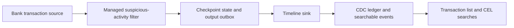

# Suspicious bank transaction pipeline

This runnable simulation sends synthetic bank transactions through a managed
filter stage and writes a timeline event for each transaction that needs review.
It finishes by querying the timeline, printing the suspicious transactions, and
running a set of investigation searches with asserted results.

```bash
cargo run -p acteon-simulation --features bus --example bank_transaction_pipeline
```

No running Kafka broker, database, or HTTP server is required. The simulation uses
the real Acteon managed-stage, checkpoint, outbox, and timeline APIs with an in-memory
source adapter, checkpoint store, and query projection and an fsynced temporary CDC ledger. The ledger is
removed on exit. All input records are fictional and the rules are illustrative;
a suspicious event means a review candidate, not a finding of fraud.

## Processing flow



The source publishes 12 unique transactions and then repeats TX-003 at another
source offset. The receipt-bearing fixture source keys records by account and
exposes a single ordered partition. It retains each delivery until the managed stage acknowledges
its exact receipt. Amounts use integer USD cents.

The filter checks three patterns:

| Reason | Demo condition |
|---|---|
| `large_new_payee` | Transfer of at least USD 10,000 to a new payee |
| `new_country_device` | An unknown device used from a country different from the account's home country |
| `rapid_transfers` | Third or subsequent transfer for an account within an inclusive 120-second window |

All transactions contribute to the relevant account's transfer window, even when
they are otherwise normal. Card payments do not increase the transfer count.
Identical transaction IDs are deduplicated before updating windows. Reusing an ID
with different contents is rejected. One event bundles all reasons matched by a
transaction; multiple reasons give it `critical` severity. Large transfers or
bursts alone are `high`; a new-country/new-device signal alone is `medium`.

The processor returns updated detector state and stable-keyed outputs without
writing to the timeline directly. The managed stage atomically checkpoints these
with the source position before acknowledging the source receipt. The outbox
worker ingests each output through `TimelineService` and completes delivery only
after ingestion succeeds. The demo drains the outbox after every input, so each
detection becomes searchable before the next input is processed.

The namespace is `banking`, the tenant is `demo-bank`, and the event type is
`bank.transaction.suspicious`. Each event uses the transaction UUID as its ID and
`bank-suspicion-v1` as its source. `eventGroup` identifies an account's daily review,
for example `review:acct-alex:2026-10-24`.

## Expected suspicious transactions

The final list is read back from the timeline in three pages of two events. It is
not assembled directly from the filter's output.

| Reference | Account | USD | Severity | Reasons |
|---|---|---:|---|---|
| TX-003 | acct-alex | 15,000.00 | high | Large transfer to a new payee |
| TX-004 | acct-casey | 300.00 | medium | New country and device |
| TX-005 | acct-alex | 900.00 | high | Rapid transfer burst |
| TX-007 | acct-casey | 20,000.00 | critical | Large new-payee transfer and new country/device |
| TX-009 | acct-blair | 12,000.00 | high | Large transfer to a new payee |
| TX-012 | acct-blair | 200.00 | high | Rapid transfer burst |

The simulation asserts six suspicious and six normal transactions. The repeated
source transaction and an explicit repeat delivery to the timeline produce no
extra event. The ledger has six CDC records and the outbox has no pending entries.
It also verifies that another tenant cannot see the events.

## Investigation searches

The simulation executes all of these expressions as `TimelineQuery.filter` and
checks the returned transaction references. The same CEL subset is accepted by
`POST /v1/timeline/query` and the admin UI.

**Find a specific transaction by its exact UUID** — returns TX-007:

```cel
attributes.transaction.id == "00000000-0000-4000-8000-000000000007"
```

**Find burst activity** — returns TX-005 and TX-012. This is scalar membership in
the event's reasons array:

```cel
"rapid_transfers" in attributes.reasons
```

**Prioritize severe events from unknown devices** — returns TX-007:

```cel
attributes.severity in ["high", "critical"] && attributes.knownDevice == false
```

**Investigate a shared counterparty across accounts** — returns TX-003 and TX-009:

```cel
attributes.counterpartyId == "payee-orion"
```

**Search the human-readable detection messages** — returns TX-003, TX-007, TX-009:

```cel
textMatch("large transfer")
```

Unscoped full-text search requires all search words across the message and string
attribute values; it is not a phrase search. For example, `textMatch("new payee")`
also matches TX-004: `new` occurs in its message and `payee` in its counterparty
ID. Use attribute equality for literal identifiers or precise classifications.

**Find large transfers to new payees** — also returns TX-003, TX-007, TX-009:

```cel
attributes.amountBucket == "large" && attributes.newPayee == true
```

`amountBucket` is computed by the detector. Numeric attribute ranges such as
`attributes.transaction.amountCents >= 1000000` are not supported by the current
timeline CEL subset; exact numeric equality remains available.

**Examine later activity** — returns TX-009 and TX-012:

```cel
occurredAt >= timestamp("2026-10-24T09:02:30Z")
```

**Read one account's daily review chronologically**, one event per page — returns
TX-003, followed by TX-005:

```json
{
  "scope": { "namespace": "banking", "tenant": "demo-bank" },
  "query": {
    "eventGroup": "review:acct-alex:2026-10-24",
    "limit": 1
  }
}
```

Pass `nextCursor` as `query.cursor` with all the other query options unchanged.
Group queries default to oldest first. The other demo searches explicitly use
ascending order to keep expected results deterministic.

## Validation and deployment boundaries

The example exits with an error if processing, output delivery, expected matches,
pagination, deduplication, or isolation assertions fail. Its unit tests additionally
cover threshold boundaries, inclusive window expiry, conflicting duplicate IDs,
and out-of-order input:

```bash
cargo test -p acteon-simulation --features bus --example bank_transaction_pipeline
```

The finite demo keeps transaction IDs in checkpoint state for deduplication and
requires event-time order per account. A long-running deployment needs a bounded
deduplication retention policy and an explicit late-data policy. Use durable state
for checkpoints/outboxes and a durable timeline projection backend; memory state
here does not survive a process restart. Source acknowledgement follows checkpoint
persistence, while timeline delivery is asynchronous and idempotent.

See [Event timeline](../features/event-timeline.md) for backend configuration,
retention, CEL semantics, and admin query controls.
